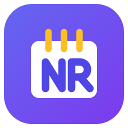
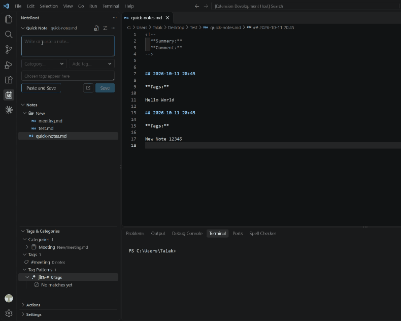
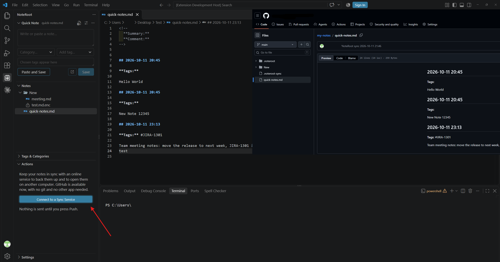
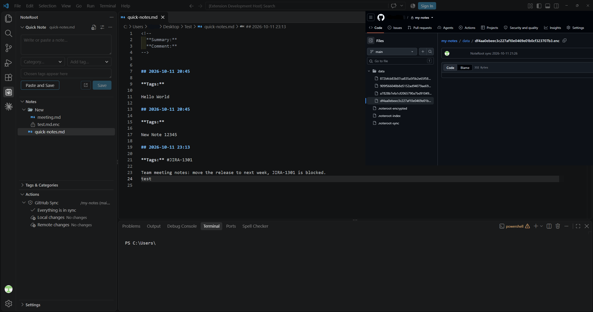

<h1 align="center">NoteRoot for Visual Studio Code</h1>

<em>Notes in a folder you choose: a notes tree, a Quick Note box, tags and categories, and optional encrypted sync to GitHub.</em>

  
  
  

## Getting started

1. Open the NoteRoot icon in the Activity Bar.
2. Choose **Select Notes Folder**.
3. Create a note with the **New File** button, or type a thought into **Quick Note**.

A walkthrough opens on first start. You can reopen it from the Welcome page (**Get Started with NoteRoot**).

## Safe and private

Your notes are plain files in a folder you pick. NoteRoot is built so you can trust it with them:

- **No telemetry, and no network unless you ask.** NoteRoot sends nothing anywhere by itself. The only feature that uses the network is **Sync**: it does nothing until you connect a service (GitHub today), and then it talks to that service only when you press a button (or switch on the optional check for new changes). NoteRoot never stores your GitHub token (VS Code keeps it). It has no runtime dependencies.
- **Your files, no lock-in.** Notes are normal files. The only thing NoteRoot adds is one small `.noteroot/config.json` in your notes folder.
- **It stays inside your notes folder.** Every file operation is checked to stay inside it. Links to folders are shown but never followed.
- **Nothing is deleted or overwritten silently.** Delete goes to the Trash. Name conflicts ask first.
- **Your notes are never logged.** The log shows file paths and short messages, never what you wrote.
- **Encrypt a note, or the whole sync, with a master key.** AES-256-GCM, the master key is never stored. See below.

## Features

### Your notes

- **Notes tree.** Browse the notes folder like the Explorer: create, rename, duplicate and delete (to the Trash), drag and drop, and drag files in from outside. **Undo** takes back the last rename or move. Sort by name or by date modified.
- **Search.** Find notes by file name or by text. A result opens at its line and is shown in the tree. It reads text files up to 1 MB and shows the first 200 results.
- **Pinned and Recent.** Pin the notes you need most; the last ones you opened are listed under them. Both follow a note when you rename or move it.
- **Note header.** Write a header once (for example a comment with a few fields such as *Summary* and *Comment*) and every new note starts with it. **Add ▸ Header** puts it into an existing note.
- **Hide what you don't want.** **Hide from NoteRoot** keeps a file or folder out of the tree, search and tags; **Show Hidden Items** brings them back in the tree. **Don't Auto-Tag** keeps them out of automatic tagging only.

### Writing and tagging

- **Quick Note.** Type a thought in the box and press **Save**: it is added to one file with a date heading, the file is not opened and your draft is kept. **Save and Open** also opens it; **Paste and Save** saves the clipboard. You choose the file, the position (end or start) and the heading style.
- **Add Selection to Quick Note.** Select text in any file, right-click, and choose **NoteRoot ▸ Add Selection to Quick Note**: it is added to the Quick Note file (or to the category you chose) like a note you typed.
- **Categories and tags.** Switch on the Advanced mode to send a Quick Note to another file (a *category*) and to add any number of *tags*. Give a category or tag a **keyword**, or a pattern such as `ab-*`, and notes that contain it are filed or tagged by themselves. Turn on *Auto Create Category for Every File* to offer every note as a category.
- **Manage categories and tags.** The **Tags & Categories** panel lists them, with the notes of each tag; select several and rename, delete, set a keyword or change the file of a category. The same actions are in **Manage Categories and Tags** in the `...` menu of the Quick Note box.
- **Run Tagging.** Right-click notes or folders to tag notes you already have, entry by entry for a file of Quick Notes. **Tag when saving** does it each time you press Save in an editor.
- **Move to.** Select text in a note, right-click, and move it into the Quick Note file or any other note. The text is removed from the source only after it was written, and Ctrl+Z brings it back. **Add ▸ Date and Tags** inserts a heading and a tag line where the cursor is.

### Everywhere

- **Sync.** Push your notes to GitHub and pull them on another computer, with no git and no other app. It can be encrypted. See below.
- **Settings panel.** Every setting is in one panel, with its value: click a row to change it, right-click to reset it or show it in the VS Code Settings editor. Settings that belong to your notes are saved in the notes folder, so they travel with it (and with Sync); those are not in the VS Code Settings editor. The panel has four groups:
  - **Notes:** the notes folder, sort order, default extension, hidden files and folders, the large file warning, the note header and which file types count as notes.
  - **Quick Note:** the Quick Note file, where new notes go (start or end), the heading and date format above each note, the line with the tags, and *Tag when saving*.
  - **Tags & Categories:** the Advanced options, *Category for every file* and *Tag from pattern* switches (and whether they start on), and the files and folders that are never tagged automatically.
  - **More:** limits and small details, such as recent notes to keep, search length and results, undo steps, double click time, how long messages stay, and *Ask before deleting*.

## Sync

Open the **Actions** panel and choose **Connect to a Sync Service**. VS Code signs you in to GitHub (NoteRoot never sees your password), then you pick a repository or create a private one. No git is needed, and more services can be added later.

- **Push** sends your changes as one commit, **Pull** brings the online ones, **Refresh** compares. Click a file for a diff. Nothing contacts the service until you press a button.
- A file changed on both sides is a **conflict**: keep yours, the online one, or both. Replaced and deleted files go to the Trash first.
- Notes folder settings are synced too; hidden files and files over 25 MB are left out unless you choose otherwise.
- Optional, off by default: checking for new changes automatically, and keeping only the last commits.
- Without encryption the notes are pushed as they are. NoteRoot warns before using a public repository.
- **Encrypted sync.** An empty repository can be encrypted before the first push (AES-256-GCM, key from your master key with scrypt), with file names kept or hidden. The master key is asked once per computer and **cannot be recovered**. The `...` menu of the panel can encrypt an existing repository, change the master key or forget the saved one. Without NoteRoot, `tools/decrypt-repo.js` (Node.js) or `tools/decrypt-repo.ps1` (PowerShell) in the project repository open a cloned repository. No independent security review yet.

## Encrypt a note

Right-click a note and choose **Encrypt…**, then type a master key twice. The note is renamed `name.ext.enc` and shows a lock. Click it (or **Decrypt for Viewing…**) to read it in a read-only editor that exists only in memory; **Decrypt Permanently…** restores the note.

- AES-256-GCM, with a key from your master key by scrypt. Tampering is detected. The file name and size stay visible.
- **The key is never stored and cannot be recovered. If you forget it, the note is lost.** Old copies (Local History, Git, backups) may still hold the plain text.
- Without the extension, `tools/decrypt.js` (Node.js) or `tools/decrypt.ps1` (PowerShell on Windows) decrypt a note. No independent security review yet.

## Good to know

- **Remote, WSL, containers.** Works in Remote windows. The notes folder is on the machine where the extension runs.
- **Two windows.** If two VS Code windows save a Quick Note in the same few milliseconds, one note could be lost.
- **Search** reads text files up to 1 MB, skips binary files, and shows the first 200 results.
- **Not included yet.** Templates, wiki-links, and undo for deleting and creating.

See the [changelog](CHANGELOG.md) for the full list of what each version does.

## Requirements

VS Code 1.140 or newer. No other extensions and no runtime dependencies.

## License

NoteRoot is free software, released under the [GNU General Public License, version 3](LICENSE).
